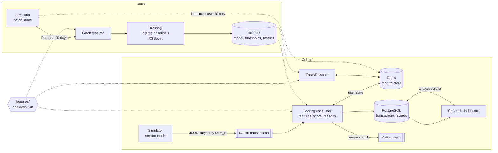
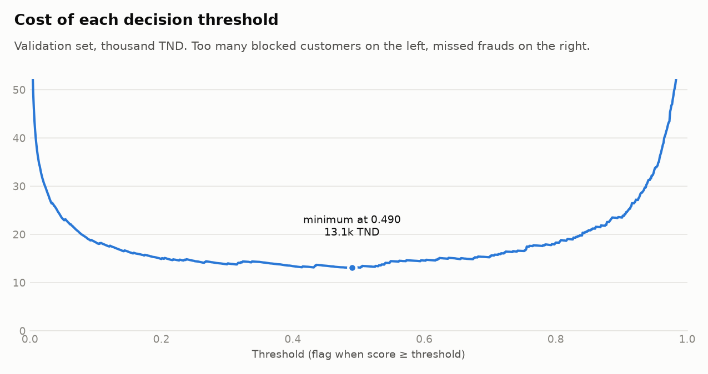
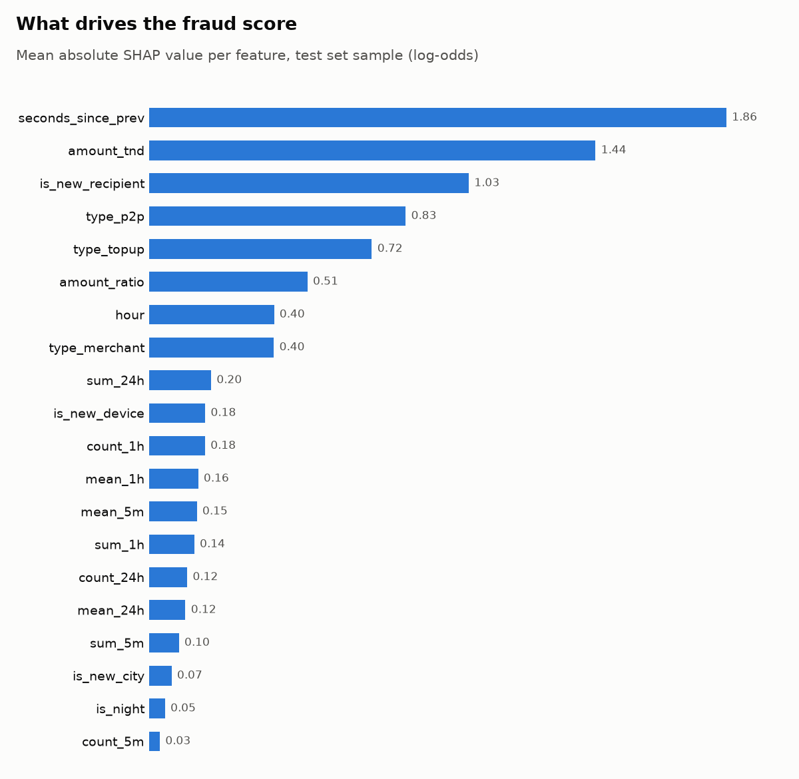

# PayGuard


Real-time fraud detection for a mobile wallet: every transaction is scored about 23 ms after it
is published, with the reasons for the score, and suspicious ones land in an analyst's queue.

## The problem

Mobile wallet fraud is fast. An attacker who takes over an account drains it with a handful of
transfers in a few minutes, and a stolen payment credential is tested with a burst of tiny
payments before the real purchase. A nightly batch job finds this the next morning, when the
money is gone. Stopping it means deciding on each transaction while it happens, using what the
user did seconds ago (a new device, a recipient never seen before, five payments in the last
minute), and doing so without blocking the honest customers who make up more than 98% of traffic.

PayGuard is an end-to-end version of that system on simulated data: a transaction simulator, a
streaming feature pipeline, an XGBoost model, a scoring API and an analyst dashboard.

## Architecture



| Component | Role |
|---|---|
| `simulator/` | 5,000 users and 500 merchants with habits (city, devices, amounts, active hours) and three fraud scenarios |
| `features/` | The 20 features, defined once and used by training, the consumer and the API |
| `ml/` | Training, threshold selection, SHAP, and the scoring library |
| `streaming/` | Kafka consumer: features, score, Redis update, PostgreSQL, alerts |
| `api/` | `POST /score`, `GET /health`, `GET /model-info` |
| `dashboard/` | Live alert queue, alert details, analyst verdicts |

## How to run

You need Docker and Python 3.13.

```bash
git clone https://github.com/azerkouka/PauGuard.git
cd PauGuard
python -m venv .venv
source .venv/bin/activate        # Windows: .venv\Scripts\activate

make install      # Python dependencies
make up           # Kafka, Redis, PostgreSQL
make generate     # 90 days of transactions -> data/transactions.parquet
make train        # model, thresholds, metrics, plots -> models/
make stream       # loads the history, starts the consumer, streams at 50 tx/s (Ctrl+C to stop)
make dashboard    # in a second terminal -> http://127.0.0.1:8501
```

`make` is not installed by default on Windows. Each target is a single command:

```bash
python -m pip install -r requirements.txt
docker compose up -d --wait
python -m simulator.generate --days 90 --seed 42
python -m ml.train
python -m scripts.run_pipeline --rate 50
python -m streamlit run dashboard/app.py
```

Other commands: `make test`, `make lint`, `make benchmark`, `make api` (scoring API on port
8010, interactive docs at `/docs`), `make check` (are the three services reachable?), `make down`.
Settings and ports are environment variables with defaults; see `.env.example`.

## Results

All numbers below are read from `models/metrics.json` and `models/benchmark.json`, produced by
`make train` and `make benchmark`. They are measured on **synthetic data** (see Limitations).

### Model

500,051 transactions over 90 days, 1.50% fraud. The split is by date: train until 4 March,
validation until 17 March, test on the last two weeks (77,631 transactions, 1.37% fraud).

| Model | PR-AUC (test) | Recall at 1% FPR (test) |
|---|---|---|
| Logistic regression (baseline) | 0.610 | 0.669 |
| XGBoost | 0.937 | 0.959 |

### Decision thresholds

The score becomes one of three decisions. Both thresholds are chosen on the validation set and
reported on the test set.

| Decision | Rule | Precision | Recall | Legit transactions flagged |
|---|---|---|---|---|
| `review` or `block` | score ≥ 0.490 | 0.432 | 0.976 | 1.78% |
| `block` | score ≥ 0.989 | 0.952 | 0.745 | 0.05% |

The review threshold minimises a cost: a missed fraud costs 200 TND, a wrongly flagged customer
5 TND (both configurable). With a 40:1 ratio the cheapest policy accepts many false alarms, which
is why precision is low at that threshold. The block threshold is the lowest score at which at
least 95% of flagged validation transactions are fraud. Recall at the review threshold is
between 0.973 and 0.979 for each of the three fraud scenarios.



### What drives the score



Every scored transaction also gets its own top three reasons in plain words, for example
"First transfer to this recipient", "New device for this user", "Made at 03:00 (night)".

### Latency and throughput

Measured by `make benchmark` on a laptop (Windows, Docker Desktop), single consumer. Latency is
end to end: from publication in Kafka to the computed score, queueing included.

| Run | Throughput | p50 | p95 | p99 |
|---|---|---|---|---|
| 2 minutes at 50 tx/s | 50.0 tx/s | 23.2 ms | 29.8 ms | 109.4 ms |

In that run 108 of the 112 frauds were flagged, with 3.5% of traffic raising an alert. A separate
60-second run at 1,000 tx/s shows where one consumer saturates: it scored 322.9 tx/s, and beyond
that rate the queue grows. The topic has three partitions, so up to three consumers can share it.

## Key design decisions

**Features are defined once, and a parity test proves it.**
The classic failure of real-time ML is training on one feature computation and serving another.
Here `features/online.py` computes the features of one transaction from the user's state, and is
the only code used at serving time (consumer and API). Training uses a vectorised equivalent for
speed, and tests assert that historical transactions pushed through the online path (Redis
included) give the same values as the batch path.

**No feature can see the future.**
Each user's transactions are put in time order and the features of a transaction only read what
came before it; the state is updated after the features are computed. A test checks that a
transaction's features are bit-identical whether or not later transactions exist.

**Temporal split, not random.**
The model is tested on the last two weeks, after everything it was trained on. A random split
would let it learn from transactions that happen after the ones it is tested on, and would hide
any drift over time.

**PR-AUC and recall at 1% FPR, not accuracy.**
With 1.4% fraud, a model that flags nothing is 98.6% accurate. PR-AUC measures the
precision/recall trade-off on the rare class, and recall at 1% FPR answers the business question:
how much fraud do we stop if we may disturb one honest customer in a hundred?

**Kafka messages are keyed by `user_id`.**
Kafka orders messages within a partition only. Keying by user sends all of a user's transactions
to the same partition, in order, which the features need ("seconds since the previous
transaction"). It also means a single consumer owns a given user's state, so no locking is needed.

**At-least-once delivery with idempotent writes.**
Offsets are committed after a batch is fully processed, so a crash replays it. Replays are
harmless: PostgreSQL inserts ignore duplicates, and the Redis update is one atomic Lua script
that does nothing if the transaction is already there. Killing the consumer mid-batch and
restarting it loses nothing and double-counts nothing.

**The consumer calls the model as a library, not through the API.**
This removes a network hop and a service that could be down, and keeps feature computation and
state update in one place. The API exists for synchronous callers and shares the same scoring
code, so both give the same scores.

## Limitations

- **Synthetic data.** The model is measured on its ability to find three scenarios that were
  programmed into the simulator. Real fraud is more varied and adversarial; expect much lower
  numbers on real data. The simulator was made harder once already, after a first version gave
  a PR-AUC of 0.998.
- **Delayed labels are not modelled.** Here the truth is known instantly and without error. In
  production a fraud is confirmed days or weeks later, some are never reported, and blocked
  transactions never get a label at all.
- **Single broker, single node of everything.** Kafka runs one broker with replication factor 1,
  and Redis and PostgreSQL are single instances: fine for a laptop, no fault tolerance.
- **One dataset, one seed.** No confidence intervals on the metrics.
- **The stream runs on a simulated clock** that restarts at 1 April 2026 on every run, so Redis is
  reloaded from the history each time.
- **No authentication** on the API or the dashboard, which is bound to localhost.
- **Alerts can be duplicated** after a consumer crash; readers must deduplicate on
  `transaction_id`.

## Roadmap (v2)

- **Drift monitoring:** compare online feature distributions with training, alert on divergence.
- **MLflow:** experiment tracking and a model registry in place of files in `models/`.
- **Retraining on analyst verdicts:** use the `analyst_labels` table to close the feedback loop,
  with delayed labels modelled.
- **Airflow:** scheduled retraining and data-quality checks.
- **dbt:** tested SQL models for reporting on top of the PostgreSQL tables.
- **Spark:** batch feature computation once the history no longer fits in memory.

## Tests

54 unit tests run without Docker (Redis is faked) in about 30 seconds, and on every push through
GitHub Actions together with `ruff`.
